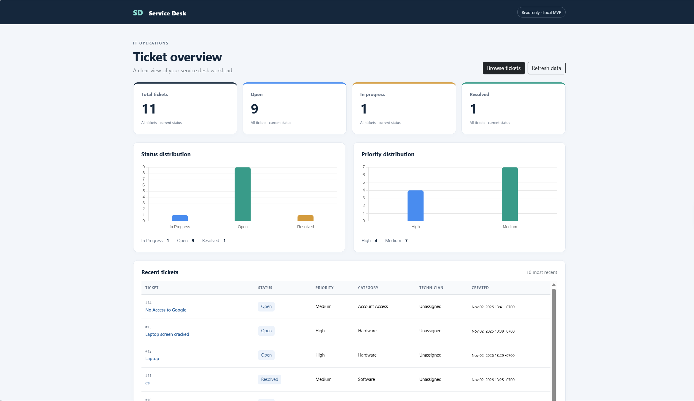
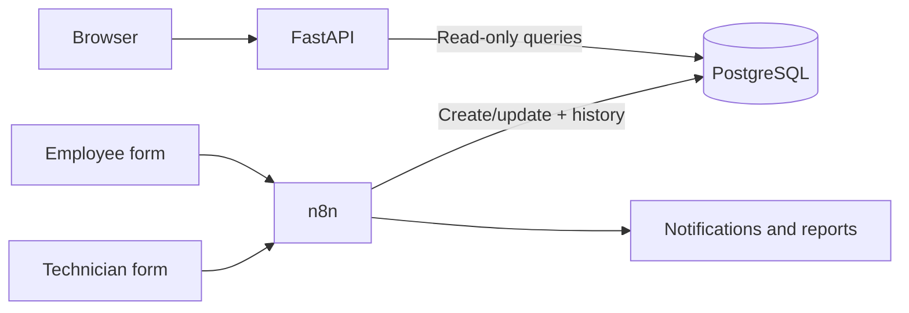
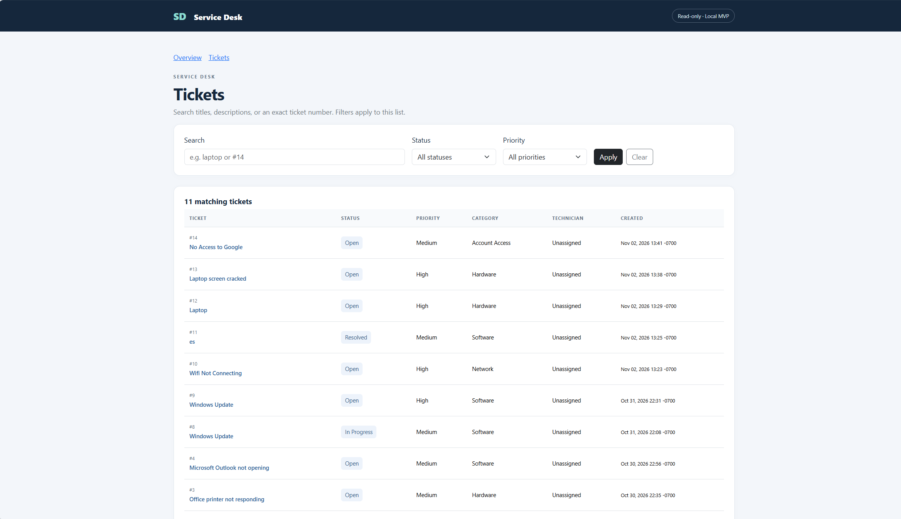
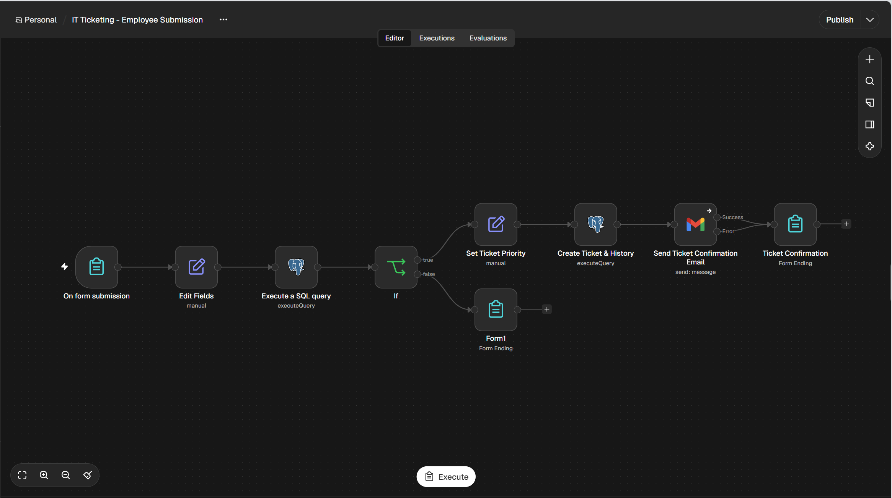
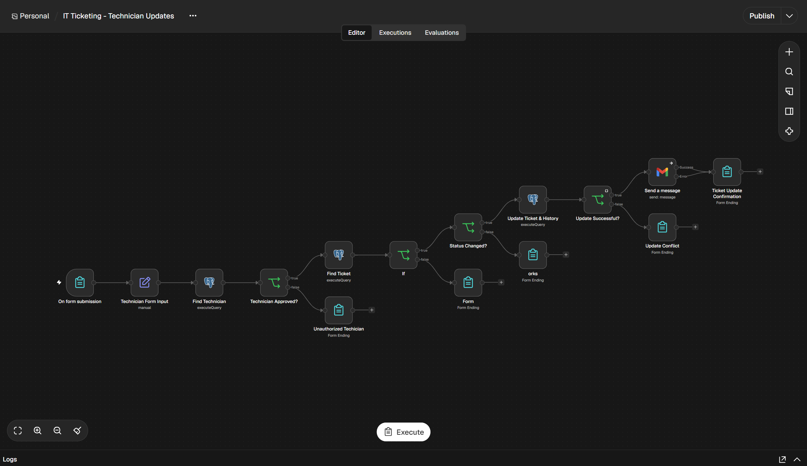
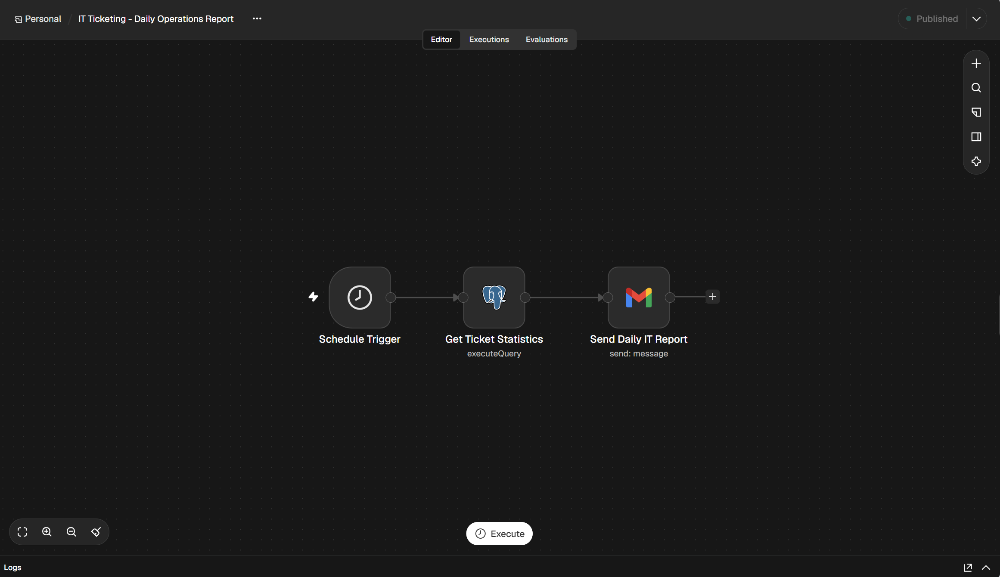

# IT Ticketing Dashboard

A local, read-only IT service dashboard built with **FastAPI, PostgreSQL 16,
Jinja2, Bootstrap, and Chart.js**. Existing **n8n + Gmail** workflows handle
employee submissions, technician updates, notifications, and daily reports.



## What it does

- Displays ticket KPIs and status/priority charts.
- Searches and filters tickets with pagination.
- Shows ticket details, assignments, and existing audit history.
- Exposes GET-only REST endpoints with interactive docs.
- Uses a dedicated database reader account and environment-based credentials.

## How it fits together



The dashboard reads existing records; n8n owns ticket changes. Pages refresh on
request rather than polling automatically.

## Run locally on Windows

Requires Python 3.13 and the existing PostgreSQL database
`n8n_it_ticketing_system`, with `users`, `categories`, `tickets`, and
`ticket_history` in the `public` schema. A fresh database is not provisioned here.

```powershell
python -m venv .venv
.\.venv\Scripts\python.exe -m pip install -r requirements-lock.txt
Copy-Item .env.example .env
```

For first setup, review and run `sql/create_reader.sql` in pgAdmin as an
administrator. Set `ticket_dashboard_reader`'s password locally in pgAdmin, then
enter it in your private `.env`. Preserve `.env` when updating; never commit it.

```powershell
.\.venv\Scripts\python.exe check_database.py
.\.venv\Scripts\python.exe -m uvicorn main:app --reload --host 127.0.0.1
```

Open **http://127.0.0.1:8000/**; API documentation is at **/docs**.
Bootstrap and Chart.js use CDN assets and require internet for full styling/charts.

## API

| GET endpoint | Result |
| --- | --- |
| `/health` | App liveness; does not check the database |
| `/api/overview` | Global KPIs, distributions, recent tickets |
| `/api/tickets` | Search/filter list; `q`, `status`, `priority`, `page` |
| `/api/tickets/{ticket_id}` | Detail and audit history; `history_page` |

Lists show 25 tickets per page; history shows 50 entries. Missing tickets return
404, invalid input 422, and database errors 503 with sanitized messages.

## Verification and scope

```powershell
.\.venv\Scripts\python.exe -m pytest -q
```

**21 automated tests** use simulated records. Connection, counts, filtering,
details, and audit history were also manually checked against the local database.
Parameterized SQL, escaped templates, read-only transactions, query timeouts, and
bounded pagination are implemented.

**Local portfolio MVP: no visitor authentication or authorization.** The database
reader login is not user login. Keep the app on loopback; it is not ready for public
hosting. Workflow screenshots show structure, not verification of every branch or
concurrent-update correctness. Original workflow exports and a database schema
installer are not included. Earlier design diagrams and private/test captures are
excluded from this release. Next steps: authentication and a standalone demo dataset.

## More screenshots

<details>
<summary>Ticket browsing and automation workflows</summary>

**Ticket browsing:** search and status/priority controls (shown unfiltered).



**Employee submission:** validation, priority assignment, ticket/history creation,
Gmail confirmation, and a form confirmation step.



**Technician updates:** technician lookup, ticket checks, status/history updates,
notification, and confirmation/conflict branches. Email lookup is not authentication.



**Daily reporting:** scheduled statistics query and Gmail report delivery step.



</details>

[David N. Serrano — portfolio](https://davidnserrano2-cmd.github.io/)
