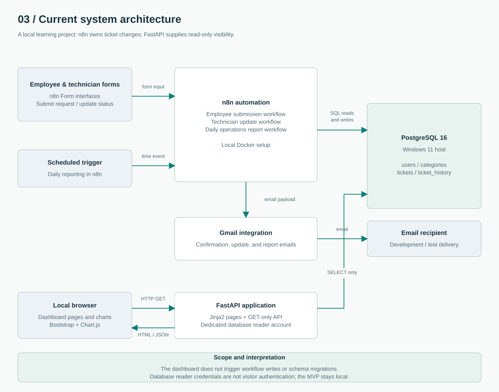
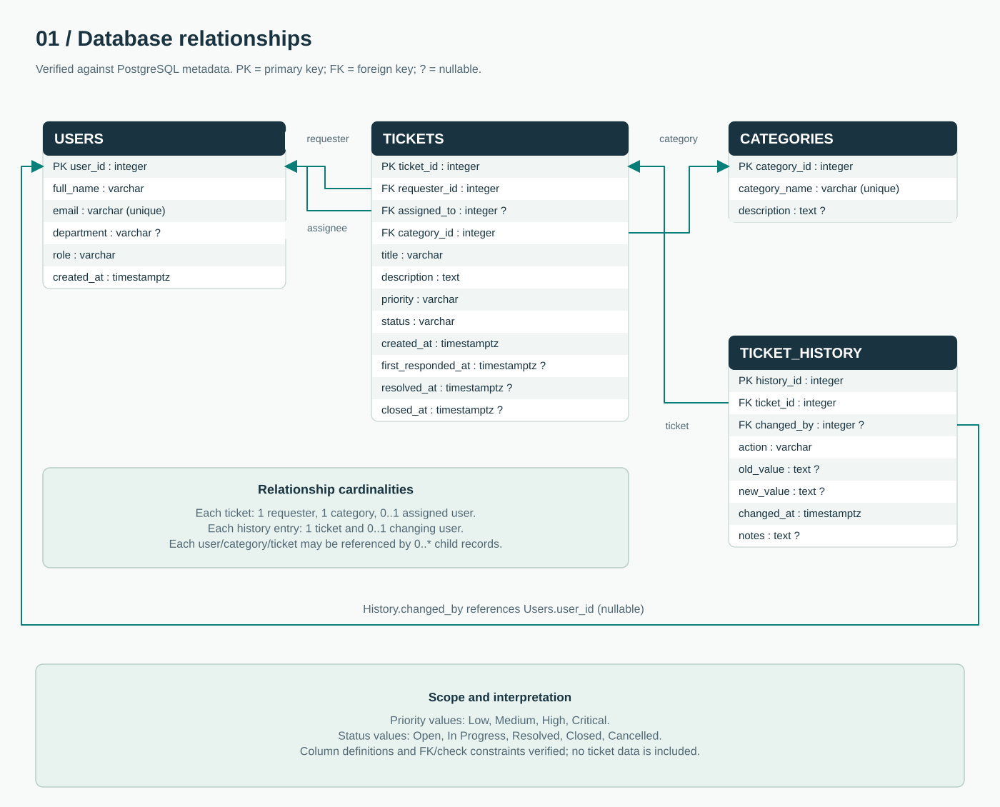

# Exploring n8n through an IT ticketing project

## Why I built it

I was curious about n8n and wanted to understand how workflow automation works.
I chose an IT support scenario so I could follow a request from a form, through
database operations and notifications, to a dashboard. This was a self-directed
learning project that grew through experimentation, testing, and troubleshooting.

My starting question was simple: how can a form submission become a stored ticket,
an email confirmation, and useful information for someone reviewing the work?

## What I explored

- Triggers and form inputs: starting a workflow and passing data between nodes.
- Conditions and lookups: finding users/categories and branching on results.
- Relational data: linking users, categories, tickets, and change history.
- Integrations: connecting PostgreSQL queries with Gmail notifications and reports.
- Visibility: adding FastAPI, Jinja2, Bootstrap, and Chart.js to inspect the records.

## What the MVP does

The employee workflow collects an email, category, title, description, and impact.
It validates references, assigns priority, creates ticket/history records, attempts
a Gmail confirmation, and returns the ticket number through the form.

The technician workflow looks up a technician and ticket, checks whether the status
changed, writes the update and history, and proceeds to notification and a form
result. A technician email lookup is not visitor authentication.

The reporting workflow uses a scheduled trigger to aggregate ticket statistics and
pass a daily operations report to Gmail. Captured report output includes totals,
open/in-progress/resolved counts, high-priority tickets, and tickets created today.

The dashboard reads PostgreSQL through a dedicated reader account. It provides KPI
cards, charts, ticket search and filters, details, existing audit history, and GET-only
REST endpoints. It does not replace the n8n workflows or update ticket records.

## Architecture and database

n8n performs the existing ticket writes. FastAPI performs read-only queries.
The browser renders Jinja2 pages with Bootstrap styling and Chart.js charts.

Each ticket references one requester and category, with an optional assigned user.
Each history entry references a ticket and optionally the user who made a change.
The history table stores action, old/new values, time, and notes. These relationships,
column names, nullability, and CHECK constraints were read from PostgreSQL metadata.

## Decisions that shaped the project

Keeping the dashboard read-only let me add visibility while preserving the existing
automation. Separating routes, SQL queries, configuration, templates, and assets made
the application easier to understand and extend. Parameterized SQL keeps search
input separate from SQL syntax; escaped templates display ticket text as text.
Pagination and timeouts bound the work done by each request.

Audit history also made the distinction between current state and recorded changes
visible. Earlier test records included repeated changes, so the public material does
not present those captures as proof of concurrent-update correctness. Diagram revisions
were another useful exercise: the final architecture now reflects what was built,
and speculative critical-alert and retry flows have been removed.

## Verification

- The user manually checked the reader connection, dashboard counts, filters, detail
  pages, and history against the local PostgreSQL database.
- The dashboard has 21 automated tests using simulated records. They cover input
  validation, parameter binding, pagination, missing/empty results, escaped HTML,
  JSON serialization, sanitized failures, and GET-only route registration.
- The final ERD and allowed status/priority values were checked against live metadata.
- Workflow canvases show structure. They do not prove every error path, database
  transaction atomicity, delivery reliability, or concurrency behavior.

## What I took from the experience

The project gave me practice following data through several tools, separating a
workflow's steps from its outputs, and using a database as a shared source of ticket
information. It also helped me see where a successful form response, an email attempt,
and a recorded database change are different things that need separate checks.

## Completion scope

The local learning MVP and its portfolio documentation are complete. It remains
without visitor authentication and should stay on loopback. Database credentials
are kept in a private environment file. A status CHECK constrains allowed values;
it does not enforce a complete transition matrix. Critical-alert workflows, retry
queues, Teams/Slack integrations, production hosting, and automatic editing through
the dashboard are not part of the delivered MVP.

Possible future work includes authenticated access, a standalone synthetic demo
database, and deeper integration tests. Those are follow-on ideas, not requirements
for this portfolio release.
